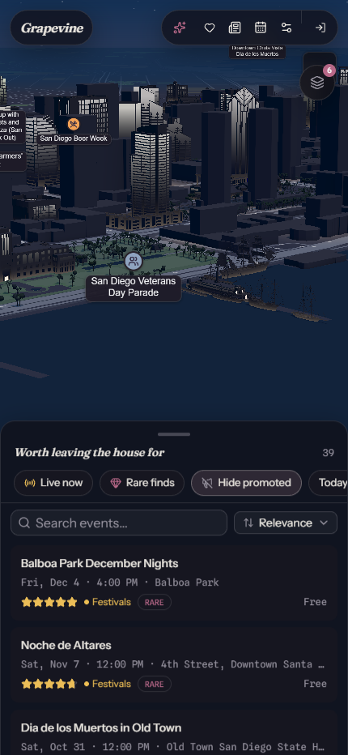
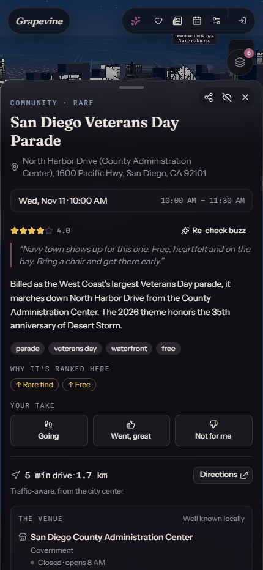
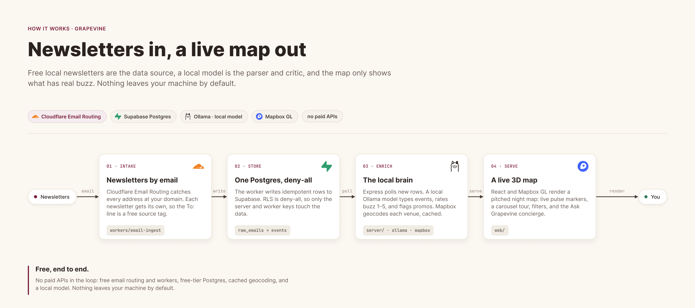
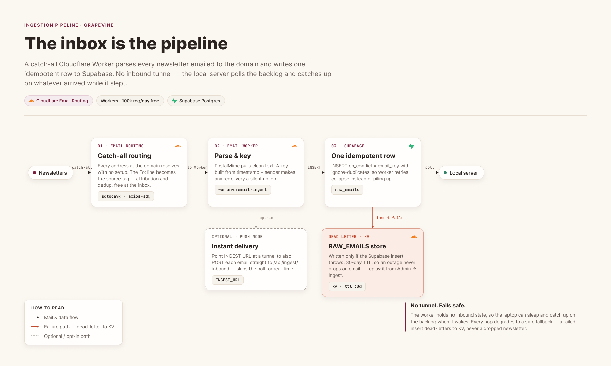
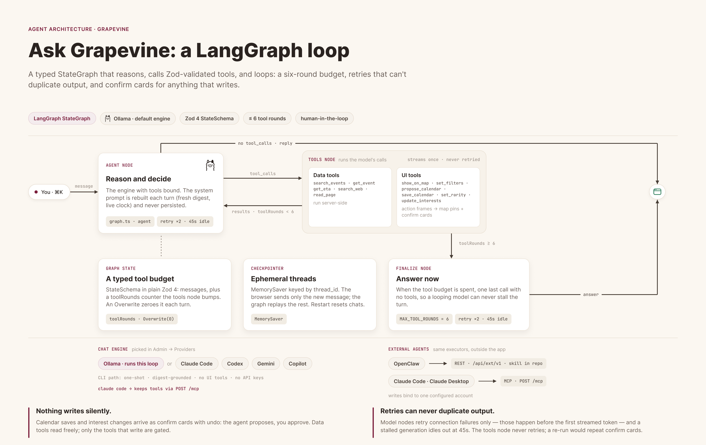
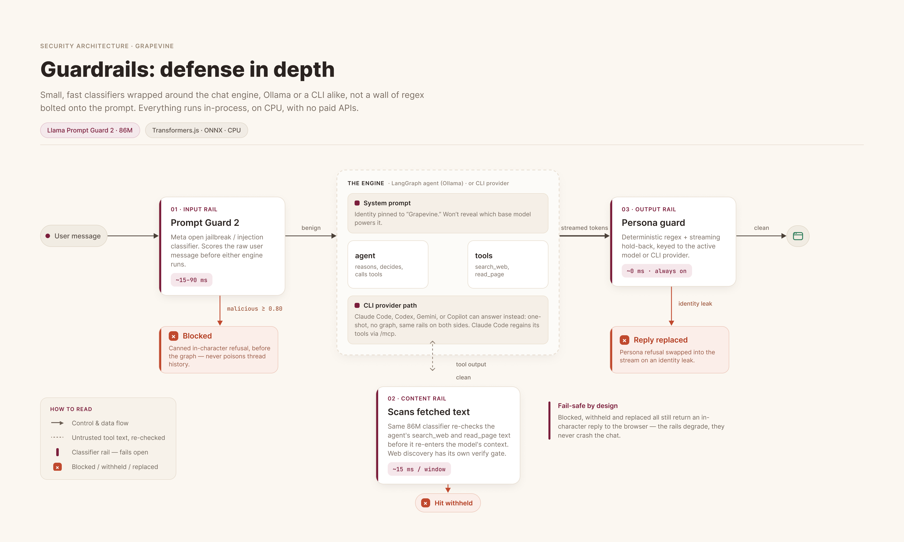
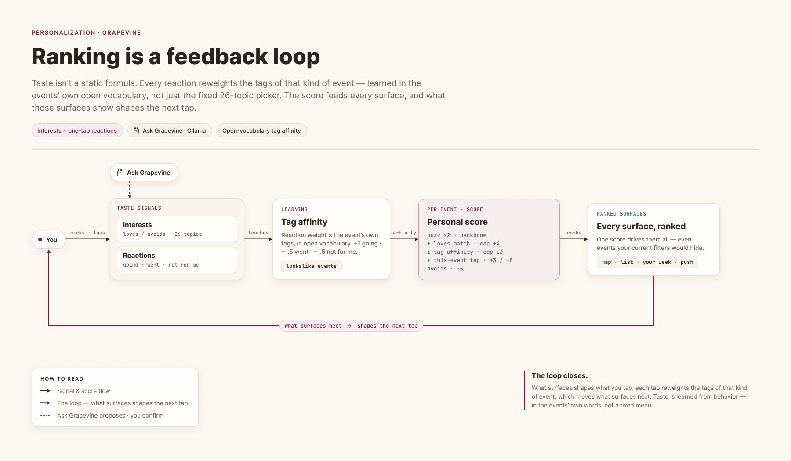

# Grapevine

**Local events worth going to, on a 3D map. Built with a validated local AI agent.**

[](https://github.com/21sean/GrapevineOS/actions/workflows/ci.yml)
[](https://github.com/21sean/GrapevineOS/releases/latest)
[](LICENSE)

[AI/ML checklist](#aiml-engineering-checklist) · [Screenshots](#screenshots) · [Quick start](#quick-start) · [Architecture](#how-it-works) · [Documentation](#documentation)

Grapevine turns local newsletters and verified web discoveries into a map of
San Diego events. Browse by date, category, and drive time, learn what is on
nearby, or ask the concierge to help plan your day.

The engineering focus is the boundary between model output and application behavior:
local inference, strict response contracts, evidence checks, bounded tool use,
and repeatable evaluations that run before changes merge.


_San Diego's waterfront in dark mode, with 3D buildings and the Star of India in view.
Extra map labels, walking paths, transit, and traffic are off. Real application capture._

**Stack:** React / TypeScript / Mapbox · Node / LangGraph · Python / Pydantic /
Instructor · Ollama · Supabase · DeepEval / Ragas / OpenTelemetry.

## AI/ML engineering checklist

Each checkmark means the capability is implemented in this repository. The evidence
column links to the code, tests, or workflow that a reviewer can inspect.

| Status | Capability                                    | Implementation and evidence                                                                                                                                                                                                                                                  |
| ------ | --------------------------------------------- | ---------------------------------------------------------------------------------------------------------------------------------------------------------------------------------------------------------------------------------------------------------------------------- |
| ✓      | Schema-gated responses                        | Ollama generates against JSON Schema; strict Pydantic and Instructor validation precedes application use, with generated Zod checks at the Node boundary. [Contracts](llm/grapevine_llm/contracts.py) · [Gateway](server/src/llm/gateway.ts)                                 |
| ✓      | Bounded repair and typed failures             | Three attempts and one 120-second deadline by default; invalid or exhausted output returns a typed failure without partial results. [Generation boundary](llm/grapevine_llm/client.py) · [Tests](llm/tests/)                                                                 |
| ✓      | Business-rule and evidence validation         | Validates dates, coordinates, known event IDs, supplied citation IDs, and verification excerpts. Answers can explicitly report insufficient evidence. [Validators](llm/grapevine_llm/contracts.py)                                                                           |
| ✓      | Agent orchestration and tool contracts        | LangGraph routes input checks, recall, model calls, tools, content checks, and finalization. Tool names and arguments are validated against the allowed set. [Graph](server/src/agent/graph.ts) · [Tool registry](server/src/agent/contracts.ts)                             |
| ✓      | Human confirmation for proposed actions       | Calendar, watch, and interest proposals have confirmation flows; applying an interest change requires `confirmed: true`. [Action contracts](server/src/agent/contracts.ts)                                                                                                   |
| ✓      | Retrieval-grounded answers                    | Upcoming event context and tool results supply evidence to the agent; supported answers must cite supplied IDs. [Context](server/src/agent/context.ts) · [Agent boundary](server/src/agent/graph.ts)                                                                         |
| ✓      | Durable conversation memory                   | Thread checkpoints and bounded running summaries preserve context across turns. [Checkpointer](server/src/checkpointer.ts) · [Recall node](server/src/agent/graph.ts)                                                                                                        |
| ✓      | Prompt and response regression evaluation     | 30 synthetic golden cases cover normal, edge, adversarial, and repair behavior; 15 also run against the pinned local model. [Dataset](llm/evals/golden.jsonl) · [Harness](llm/grapevine_llm/evals.py)                                                                        |
| ✓      | Local LLM-as-judge evaluation                 | DeepEval scores explicit rubrics after deterministic checks; agent cases add groundedness and relevance criteria. [Quality runner](server/scripts/llm-quality.ts)                                                                                                            |
| ✓      | Retrieval precision and recall                | Ragas ID-based metrics score versioned retrieval snapshots with explicit empty-set behavior. [Metrics](llm/grapevine_llm/retrieval_metrics.py)                                                                                                                               |
| ✓      | Reproducible model evaluations                | Runtime and model digests, seed, dependency locks, dataset hashes, and source fingerprints accompany quality artifacts. [Model pins](llm/evals/models.json) · [Provenance](llm/grapevine_llm/provenance.py)                                                                  |
| ✓      | CI quality and regression gates               | Requires complete cases, first-pass schema success ≥95%, required judge scores ≥0.75, and no per-case regression against the checked-in and PR-base baselines. [Gates](llm/grapevine_llm/checks.py) · [CI](.github/workflows/llm-quality.yml)                                |
| ✓      | Prompt-injection defenses and red-team suites | Local input/content classification, an output persona filter, adversarial fixtures, and a separate red-team suite. Classifier failure behavior is documented below. [Guardrails](server/src/agent/guardrails.ts) · [Red team](server/src/evals/suites/guardrails-redteam.ts) |
| ✓      | Local inference and offline evaluation        | Loopback-only model endpoints, network-denial guards, local datasets/judges, and disabled evaluator uploads. [Offline guide](llm/README.md#offline-operation-tracing-and-ci) · [Network tests](llm/tests/)                                                                   |
| ✓      | Observability and feedback into evaluations   | Local OpenTelemetry traces record attempts, failures, model time, validation time, and repair time. A sampled review queue supports reviewed promotion into golden cases. [Telemetry](llm/grapevine_llm/telemetry.py) · [Maintenance](llm/grapevine_llm/maintenance.py)      |
| ✓      | Personalized ranking                          | Event reactions update tag-affinity weights shared by the UI and server ranking surfaces. This is a deterministic scoring system. [Affinity logic](shared/affinity.ts)                                                                                                       |

### What the checks establish

- **Schema validity and factual correctness are separate.** Citation IDs and excerpt
  checks constrain outputs; they do not prove every claim is true. Complete agent
  answers validate before display, trading token-by-token rendering for a strict boundary.
- **The evaluation set is a regression suite, not a general accuracy benchmark.**
  Retrieval metrics use stored snapshots, not the live database retriever. The
  starter judge uses the same model as generation; [human calibration](llm/calibration.md)
  is documented but not yet recorded.
- **Offline scope is inference and evaluation.** The live product still uses
  Supabase, Mapbox, and optional web integrations. The prompt-injection classifier
  can run in blocking, observe, or off mode and fails open if unavailable; the
  structured-output boundary fails closed.

See the [quality guide](llm/README.md) for reproducing the gates and the
[README review](docs/readme-review.md) for the hiring-manager audit and remaining evidence gaps.

## Explore the city

- **See events in context.** A pitched Mapbox map, category icons, live event
  markers, and a tour that moves between current events.
- **Find your kind of plans.** Search, dates, rare finds, category filters,
  drive-time areas, and rankings that respond to your interests and reactions.
- **Keep the details close.** Venue information, directions, calendar conflicts,
  event sharing, and calendar export sit alongside the map.
- **Ask for help.** The concierge searches the event catalog, suggests day plans,
  and proposes calendar saves, watches, and interest changes for you to confirm.

Run the agent with local Ollama models through strict, validated output contracts.
Supabase stores events and account data, and Mapbox supplies the map and location
services. Optional integrations add newsletter delivery, Google Calendar sync,
push reminders, and tracing.

## Screenshots

Desktop and phone captures use the same dark waterfront view, with 3D buildings
enabled and optional map clutter hidden. The phone layout keeps the skyline
visible above the event list and detail sheet.

<p align="center">
  
  
</p>

_Browse events, then open the details. Capture settings and camera positions are
recorded in the [screenshot guide](docs/screenshots.md)._

## Quick start

You need **Node 22.23.3** (pinned in [.nvmrc](.nvmrc)), a **Supabase project**,
a **Mapbox account**, **Python 3.12 + uv**, and a **local Ollama model**.
See [setup and operations](docs/setup.md) for supported Node versions and the
full configuration walkthrough.

### 1. Install

```bash
git clone https://github.com/21sean/GrapevineOS.git
cd GrapevineOS
npm ci
uv sync --directory llm --frozen --group eval
```

### 2. Configure

Copy the templates and fill in your credentials:

```bash
cp server/.env.example server/.env
cp web/.env.example web/.env.local
```

| File             | Required configuration                                                    |
| ---------------- | ------------------------------------------------------------------------- |
| `server/.env`    | `SUPABASE_URL`, `SUPABASE_SECRET_KEY`, `MAPBOX_SECRET_TOKEN`              |
| `web/.env.local` | `VITE_SUPABASE_URL`, `VITE_SUPABASE_PUBLISHABLE_KEY`, `VITE_MAPBOX_TOKEN` |

On Windows, use `Copy-Item` in place of `cp` if needed. Keep secret keys in the
server environment. The browser uses publishable and public tokens.

Link your Supabase project and apply the migrations with its CLI:

```bash
supabase link --project-ref <your-project-ref>
supabase db push
```

Install Ollama and select a local model for both chat and extraction.
The quality baseline pins `qwen3.8:27b` and Ollama 0.40.8. Follow the
[structured inference guide](llm/README.md) for setup and offline operation.
Hosted subscription CLI generation is disabled in this profile.

### 3. Run and add events

```bash
npm run doctor
npm run dev
```

Open **http://localhost:5174**. The API listens on **http://localhost:8787**.
On Windows, `./scripts/dev-local.ps1` starts both services with a supported
Node runtime, using Codex's bundled runtime if the Node on your PATH is too old.
A fresh database starts empty. Paste a newsletter into **Admin → Ingest**, or
use **Admin → Discover** to review and add verified events.

Press **Ctrl K** on Windows and Linux, or **⌘K** on macOS, to open Ask Grapevine.

## How it works

Newsletter or discovery text → schema-gated extraction and verification → stored
events → map and ranking. The concierge reads event context and tool results,
validates its next action or complete answer, and exposes proposals through the UI.

<details>
<summary>Explore the ingestion, agent, guardrail, and ranking diagrams</summary>

### From newsletters to the map

Newsletters become structured events, enriched with local buzz ratings and
venue coordinates, then appear on the 3D map. Local models handle extraction;
Supabase and Mapbox provide hosted storage and location services.

<p align="center">
  
</p>

### Newsletter delivery

The email worker parses incoming newsletters and stores them once. Delivery
recovery keeps failed inserts available for retry.

<p align="center">
  
</p>

### Ask Grapevine

The agent screens messages, recalls conversation context, calls validated
tools, and keeps durable thread memory. Actions that write arrive as proposals
for you to confirm.

<p align="center">
  
</p>

### Guardrails

Input and fetched content pass through classifier checks. A separate output
filter checks the validated answer before display. The
[technical guide](docs/product-guide.md#guardrails) explains the checks and
their failure behavior.

<p align="center">
  
</p>

### Interest learning

Interests and event reactions adjust tag affinities and personal scores. The
same ranking signals feed the map, event list, weekly view, and notifications.

<p align="center">
  
</p>

</details>

See the [product guide](docs/product-guide.md) and
[agent architecture](docs/agent-architecture.md) for the complete walkthrough.

## Documentation

| Guide                                                | Covers                                                                           |
| ---------------------------------------------------- | -------------------------------------------------------------------------------- |
| [Structured inference and evals](llm/README.md)      | Strict contracts, offline model calls, quality gates, and baselines              |
| [Setup and operations](docs/setup.md)                | Accounts, configuration, deployment, auth, email delivery, and optional services |
| [Product and technical guide](docs/product-guide.md) | App tour, event ingestion, discovery, ranking, guardrails, MCP, and REST         |
| [Agent architecture](docs/agent-architecture.md)     | LangGraph state, tool contracts, streaming, and durable memory                   |
| [Mapbox Places](docs/mapbox-places.md)               | Venue lookups, scope requirements, caching, and quotas                           |
| [Changelog](docs/CHANGELOG.md)                       | Release notes and project history                                                |
| [Contributing](.github/CONTRIBUTING.md)              | Development workflow, tests, evals, and migrations                               |
| [Security](.github/SECURITY.md)                      | Trust boundaries and reporting a vulnerability                                   |

## Development

One workspace install covers the API, web app, and email worker.

```bash
npm run typecheck
npm test
npm run build
npm run lint
npm run format:check
npm run contracts:check
```

CI also requires schema/version checks, 30 deterministic golden cases, and
15 pinned local model cases with local judges. See the
[structured inference guide](llm/README.md) for adding schemas, eval cases,
and reviewed baselines. Existing offline and red-team suites remain available.

| Directory               | Purpose                                                                    |
| ----------------------- | -------------------------------------------------------------------------- |
| `web/`                  | React UI, Mapbox rendering, filters, event details, and chat               |
| `server/`               | Express API, LangGraph agent, integrations, MCP, and evaluations           |
| `shared/`               | Domain types, recurrence, ranking signals, and time calculations           |
| `llm/`                  | Python contracts, local inference, golden cases, judges, and quality gates |
| `contracts/llm/`        | Immutable versioned JSON Schemas for cross-language validation             |
| `workers/email-ingest/` | Cloudflare newsletter intake and delivery recovery                         |
| `supabase/`             | Database migrations                                                        |
| `docs/`                 | Setup, architecture, product guide, and UI screenshots                     |

Licensed under [Apache-2.0](LICENSE). See the
[third-party notices](docs/THIRD_PARTY_NOTICES.md) and
[code of conduct](.github/CODE_OF_CONDUCT.md).
