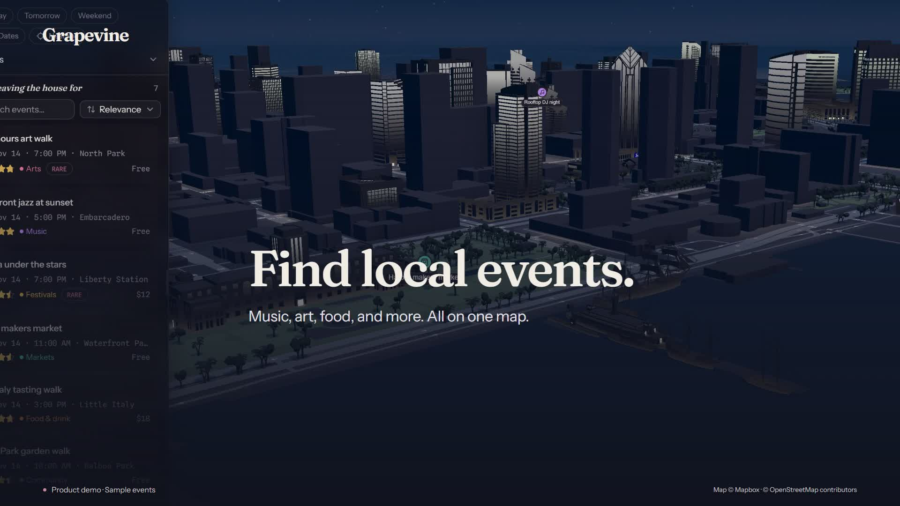

# Product demo

The 60-second demo linked at the top of the [README](../README.md) shows event discovery,
filters, interests, chat suggestions, calendar confirmation, and mobile details.
The updated video was made on November 12, 2026 using the v0.8.1 application.

The README includes an 11-second animated preview. Select the preview or the
full-demo link for the complete 1080p MP4.

## Scenes and captions

| Time    | On-screen headline                   | Feature                                                |
| ------- | ------------------------------------ | ------------------------------------------------------ |
| 0-5 s   | Find local events.                   | San Diego's 3D waterfront map                          |
| 5-12 s  | See what's happening around you.     | Event list and map                                     |
| 12-20 s | Filter by date, price, and distance. | Date, free-event, category, and drive-time controls    |
| 20-27 s | Events that match your interests.    | Jazz, art, and outdoors preferences                    |
| 27-40 s | Ask Grapevine to plan an evening.    | A sample request, streamed reply, and event highlights |
| 40-48 s | Save the plan to your calendar.      | Review, confirmation, and Undo                         |
| 48-54 s | Take the plan with you.              | Mobile event list, details, and directions             |
| 54-60 s | Find your next event.                | Get started at the repository                          |

Sample prompt: "Plan a free Saturday evening with live music and art."

Illustrative response:

> Start with **Waterfront jazz at sunset** at 5 PM, then explore the
> **After-hours art walk** at 7 PM. Both are free.
>
> I pinned both on your map. Want to save them to your calendar?

## Capture notes

The video uses the real app UI and Mapbox geometry with fictional events, an
example profile, a scripted AI reply, and a simulated calendar connection.
Calendar saves affect only the capture harness's in-memory fixtures.

The opening camera is captured at fixed steps for smooth playback. The response
is sent through the app's normal stream format at a controlled cadence, and
scenes are edited for pacing. This video demonstrates the interface and workflow;
it does not measure model latency. Sample-data and illustrative-response labels
remain visible in the video.

The export is 1920 x 1080 at 30 fps, with H.264 video and AAC audio. It has
on-screen captions and original instrumental music, with no narration. Map
attribution is visible throughout. Fonts are Fraunces and Instrument Sans under
their SIL Open Font Licenses.

The original draft, updated script, editable composition, source captures, and
full-resolution export are also preserved locally. The MP4 is available as a
[v0.8.1 release asset](https://github.com/21sean/GrapevineOS/releases/download/v0.8.1/Grapevine-demo-v0.8.1-1080p.mp4).
